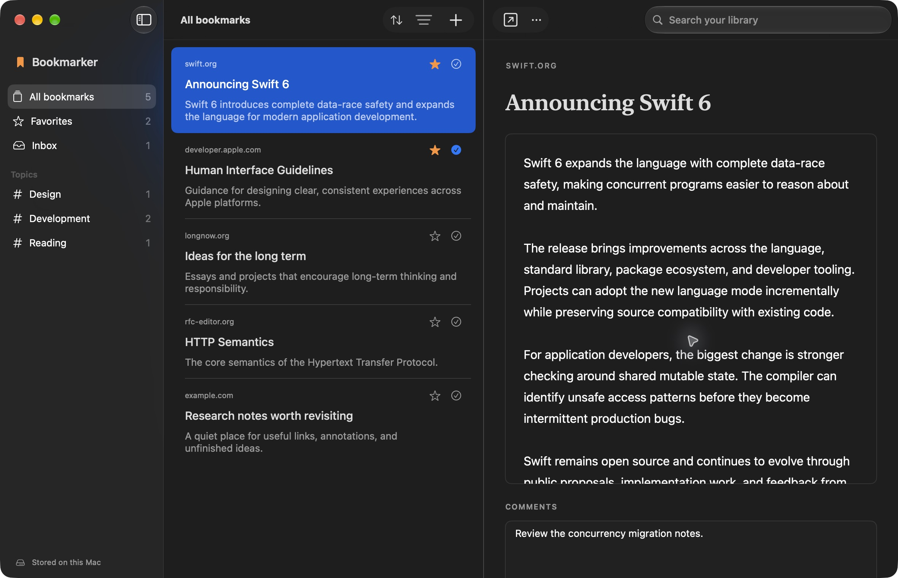

# Bookmarker

A **minimal**, private bookmark library built natively for macOS. Save pages from Safari, read clean offline copies, search downloaded text, and keep your library in iCloud Drive.

<p align="center">
  
</p>

## Features

- Minimal interface that stays focused on saving, organizing, and reading.
- Save the current webpage from Safari's context menu.
- Search titles, URLs, descriptions, topics, comments, and downloaded article text.
- Read clean local copies offline.
- Organize bookmarks with an inbox, topics, favorites, and read status.
- Store each bookmark as portable JSON in iCloud Drive or any folder you choose.
- Keep seven daily local backups automatically.

## Install

Download the latest `Bookmarker.zip` from [Releases](../../releases), unzip it, and move **Bookmarker.app** to Applications.

Bookmarker looks for its library in `iCloud Drive/Bookmarker/Library`. If iCloud Drive is unavailable, it uses a local library. You can select another folder in **Bookmarker → Settings**.

## Enable the Safari extension

1. Open Bookmarker once.
2. Open **Safari → Settings → Extensions**.
3. Enable **Save to Bookmarker**.
4. Right-click an HTTP or HTTPS webpage and choose **Save to Bookmarker**.

Ad-hoc development builds also require **Allow unsigned extensions** in Safari's Developer settings. Safari resets that option when it quits.

## Build from source

Requires macOS 14 or later, Swift 6, and the Apple command-line developer tools.

```sh
git clone https://github.com/meraccos/bookmarker.git
cd bookmarker
./scripts/build-app.sh
open dist/Bookmarker.app
```

Run the checks with:

```sh
./scripts/swift.sh run BookmarkChecks
./scripts/check-library.sh
```

## Privacy

Bookmarker has no analytics, advertising, account, or hosted backend. It connects only to pages you save to fetch metadata and readable text, and to iCloud Drive when you use an iCloud-backed library.
